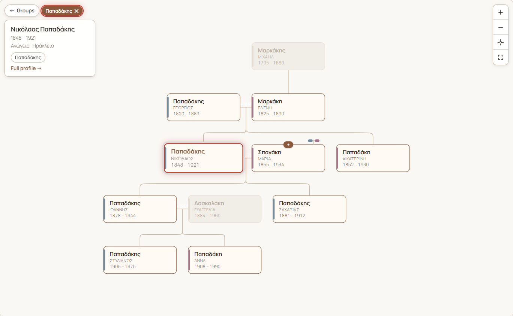

# GeoTour GenoRoots

Family trees for WordPress. Import GEDCOM files, let visitors explore family
groups and an interactive tree, and give every person their own page.

Built for a Cretan village archive ([kamilari.org.gr](https://kamilari.org.gr))
and a regional site ([geotour.gr](https://www.geotour.gr)), but nothing in it
is tied to either: it runs on any WordPress site.



*The tree for the invented sample family in [`tests/fixtures/sample-family.ged`](tests/fixtures/sample-family.ged), on a plain Twenty Twenty-Five site.*

- **Groups explorer.** Every family group is a bubble. Pick one and the
  groups that share members with it gather around it, overlaps drawn to
  scale. Pick a group or an overlap to list its members.
- **Interactive tree.** A focus-centred tree built on
  [family-chart](https://github.com/donatso/family-chart). It loads more as
  you click, and highlights the members of the chosen groups.
- **Person pages** with portrait, dates, places, notes, sources and links
  to relatives.
- **GEDCOM 5.5 import and export**, round-trip safe, with a few extension
  tags for groups, periods and certainty.
- **Collections:** several unrelated family networks on one site, each with
  its own explorer.
- **Conversion from the "Genealogical Tree" plugin**, keeping people's old
  numbers and URLs.
- **WP-CLI** for everything, with dry runs and rehearsals that roll back.
- **Bilingual:** English interface with a full Greek translation. Dates are
  shown in the page language.
- **Optional Piwigo link:** people are matched to photos in a Piwigo
  gallery by a number in the tag name.

## Requirements

- WordPress 6.0 or newer
- PHP 8.2 or newer
- [Advanced Custom Fields](https://wordpress.org/plugins/advanced-custom-fields/)
  (the free version is enough; Pro works too)

## Install

1. Download `geotour-genoroots.zip` from the
   [latest release](https://github.com/nikolakakis/geotour-genoroots/releases/latest).
2. In WordPress: **Plugins → Add New → Upload Plugin**, choose the zip, then
   **Activate**.
3. Install and activate Advanced Custom Fields if you haven't already.

The repository itself doesn't include the built JavaScript and CSS. To run
it from a clone, see [Development](#development).

## Quick start

1. **GenoRoots → Import GEDCOM**: choose a `.ged` file and click
   **Upload**. "Only check the file" is ticked at first, so the first run
   only reports what would be created, without saving anything. Untick it
   and upload again to import. To try it out, use
   [`tests/fixtures/sample-family.ged`](tests/fixtures/sample-family.ged),
   a small invented family.
2. Visit `/family-tree/` on your site. That page shows the groups explorer,
   the tree and an A–Z list.
3. To put the explorer on a page of your own instead, add
   `[genoroots_app]` to it. On themes with a sidebar, give that page a
   full-width layout.

The same import from the command line:

```bash
wp genoroots import tests/fixtures/sample-family.ged
```

## Addresses

| Page | Default address | Setting |
|---|---|---|
| Explorer and tree | `/family-tree/` | Family tree page |
| One person | `/person/<name>/` | Person pages |
| One group | `/family-group/<group>/` | Group pages |
| One collection | `/collection/<collection>/` | Collection pages |

Change the words under **GenoRoots → Settings → Addresses**. Changing a
word moves those pages, and links to the old address stop working.

Sites that ran GenoRoots before 1.0 keep the words they had (`/mele/`,
`/melos/`, `/oikogeneia/`, `/syllogi/`). A theme can still override the
setting with the `genoroots_slugs` filter (see [Hooks](#hooks)).

## Shortcodes

| Shortcode | Shows |
|---|---|
| `[genoroots_app]` | The groups explorer and tree. Use it once per page. |
| `[genoroots_app collection="papadakis"]` | The same, for one collection only. |
| `[genoroots_tree person="123"]` | One embedded tree around a person (post ID). Optional: `group="slug"` highlights a group; `up="2"` and `down="2"` set how many generations are shown. |
| `[genoroots_family_link]` | On an article about a person: a "Family tree →" link to their page. Prints nothing when no person points to the article. |

## People, families and groups

- **People** and **families** are post types. Edit them under
  **GenoRoots**. Parents, marriages and children are edited on the
  person's screen.
- **Groups** are a flat list (a taxonomy). A person can be in several
  groups, e.g. a woman in the group she was born into and in her
  husband's. "Groups" rather than "families" is deliberate: membership is
  sometimes uncertain.
- Each person has a permanent **GenoRoots ID** (`I384`). It comes from the
  GEDCOM file or the old plugin. People added by hand get the next free
  number. Never renumber: the ID is how photos, bundles and re-imports find
  the person.
- **Related article:** a person can point to one page on the site about
  them, e.g. a biography. It shows as a button on the person page and as
  "Read more →" in the tree. Any public content type can be chosen (filter:
  `genoroots_related_post_types`).

## Collections

A site with unrelated family networks puts each in a **collection**
(GenoRoots → Collections). Each collection has its own page with its own
groups explorer, search and A–Z list. `/family-tree/` then lists the
collections. A person can be in more than one collection. With no
collections, `/family-tree/` is a single shared explorer.

```bash
wp genoroots import papadakis.ged --collection=papadakis --collection-name="Papadakis family"
```

IDs inside a collection are stored as `papadakis:I1`, so files that all
number from `@I1@` never overwrite each other. Re-importing the same file
updates it.

## GEDCOM import

**What is read:** `NAME`, `SEX`, `BIRT`/`DEAT`/`BURI` (`DATE`, `PLAC`),
`NOTE` and inline `SOUR` text (with `CONT`/`CONC`), and `FAMC`/`FAMS`. In
families: `HUSB`/`WIFE`/`CHIL` and `MARR`. Pointers to separate `SOUR`
records are not followed.

GenoRoots also reads its own extension tags (other programs ignore them):

| Tag | On | Sets |
|---|---|---|
| `_GROUP` | person (repeatable) | Group membership, by group name (or slug). A missing group is created with that name. |
| `_PERIOD` | person | Historical period |
| `_ARTICLE` | person | Related article, as a path on the importing site (`people/nikolaos-papadakis`) |
| `_STATUS` | family | Certainty: `confirmed`, `probable` or `claimed` |

**Re-imports are safe.** People and families are matched by ID and
updated, never duplicated, and nothing is deleted. Notes, sources, burial,
period, groups and article are only written when the file has them, so
hand edits to other fields survive a re-import.

**Add only** (`--add-only`, or the checkbox on the import page) extends a
tree without changing it:

- People already on the site are only anchors. Nothing about them is
  rewritten.
- Families already on the site only gain new children, an empty spouse
  slot, or an empty marriage date or place.
- Everything else in the file is created.

The file check lists what each existing family will gain. It also warns
when an ID in the file belongs to someone with a different name on the
site. That is a numbering mistake that would attach people to the wrong
person.

## GEDCOM export

**GenoRoots → Export GEDCOM**, or:

```bash
wp genoroots export papadakis.ged --collection=papadakis
wp genoroots export spanakis.ged --collection=papadakis --group=spanakis
```

- Everything the import reads is written back in the same tags. The export
  also includes the Latin-script name as a second `NAME`, and the portrait
  URL as `OBJE`/`FILE`.
- Only published people are exported. A family is kept when at least two of
  its members are selected, and it lists only them.
- Re-importing an export into the same collection changes nothing.
- The file contains personal data, so the export page is for administrators
  only.

## Languages

- The interface is in English, with a Greek translation in `languages/`.
  The tree's labels come from the same catalogue. Add a language by
  translating `languages/geotour-genoroots-el.po` into a new `.po` file and
  compiling it (`wp i18n make-mo languages`).
- GEDCOM dates are shown in the page language: "23 AUG 1848" becomes
  "23 Αυγούστου 1848", "ABT 1820" becomes "περ. 1820". Free-text dates are
  shown as entered.
- Names, places, notes and group names are stored once and read through
  WordPress's standard functions, so a translation plugin that filters
  those can translate them.
- Name order on tree cards: surname first by default; switch with the
  `genoroots_name_order` filter.

## Piwigo photo archive (optional)

If your photos live in a [Piwigo](https://piwigo.org) gallery, GenoRoots can
link each person to their photos.

1. Tag the photos with the person's name and GenoRoots ID number in
   brackets, e.g. "Maria Papadaki [384]" for ID `I384`. Keywords set in
   Lightroom or another photo tool work, through Piwigo's metadata sync.
2. Enter the gallery address under **GenoRoots → Settings**, then click
   **Preview** and **Sync now**, or run `wp genoroots piwigo-sync`.
3. Person pages and the tree then show "Photos (N) ↗".

GenoRoots only reads from Piwigo, and only when you run the sync. Piwigo's
own tag numbers change when a gallery is rebuilt; the sync matches by the
number in brackets, so running it again fixes the links.

## Converting from Genealogical Tree

GenoRoots can take over from the
[Genealogical Tree](https://wordpress.org/plugins/genealogical-tree/) plugin
(free or Pro). The conversion reads the old plugin's data directly and
leaves it untouched; both plugins can be active at the same time. People
keep their old post number as their GenoRoots ID, and old URLs redirect
once the old plugin is deactivated.

Step by step: [docs/MIGRATING-FROM-GENEALOGICAL-TREE.md](docs/MIGRATING-FROM-GENEALOGICAL-TREE.md).

## Moving data between sites

A **bundle** is one JSON file with people, families, fields, groups and
collections, keyed by GenoRoots ID so post IDs can differ between sites.

```bash
# on the source site
wp genoroots export-bundle ~/bundle.json
# on the target site
wp genoroots preflight
wp genoroots import-bundle ~/bundle.json --dry-run
wp genoroots import-bundle ~/bundle.json
wp genoroots verify-bundle ~/bundle.json
```

Imports run in one database transaction: if anything fails, nothing is
saved. `--rehearse` does the whole import, checks it, then rolls it back.
`--only-groups` and `--skip-groups` limit an import to, or exclude, group
memberships. Bundles hold personal data, so delete them from servers when
you're done.

## WP-CLI reference

| Command | Does |
|---|---|
| `wp genoroots import <file>` | Import a GEDCOM file. `--collection`, `--collection-name`, `--add-only` |
| `wp genoroots export <file>` | Export GEDCOM. `--collection`, `--group` |
| `wp genoroots preflight` | Check the site is ready: PHP, ACF, addresses, caches |
| `wp genoroots import-legacy` | Convert from Genealogical Tree. `--dry-run`, `--rehearse`, `--skip-groups`, `--save-bundle=<file>` |
| `wp genoroots export-bundle <file>` | Write a bundle |
| `wp genoroots import-bundle <file>` | Read a bundle. `--dry-run`, `--rehearse`, `--skip-groups`, `--only-groups` |
| `wp genoroots verify-bundle <file>` | Compare the site with a bundle, record by record |
| `wp genoroots piwigo-sync` | Link people to Piwigo tags. `--piwigo=<address>`, `--dry-run` |

`wp help genoroots <command>` shows every option.

## REST API

Read-only, public, and limited to published records. Namespace
`geotour-genoroots/v1`:

| Route | Returns |
|---|---|
| `GET /focus?person=<id>&up=2&down=2` | A person's neighbourhood for the tree |
| `GET /search?q=<text>` | People matching a name |
| `GET /groups` | All groups, their sizes and how many members each pair shares |
| `GET /members?groups=a,b` | Members of all the given groups (`q`, `page`) |

Every route except `/focus` accepts `collection=<slug>`.

## Hooks

| Filter | Changes |
|---|---|
| `genoroots_slugs` | The address words. Runs after the Settings value. |
| `genoroots_name_order` | `surname-first` (default) or `given-first` |
| `genoroots_related_post_types` | Which content types a person's related article can be |

```php
add_filter( 'genoroots_slugs', fn( $s ) => array_merge( $s, array(
	'people' => 'family-trees',
	'person' => 'person',
) ) );
```

## Privacy

Genealogy is personal data, and much of it is about living people.
GenoRoots shows every **published** person to everyone: the pages, the tree
and the REST API all expose them. It has no automatic "living person"
filter.

- Keep people who don't want to be public as drafts. A draft has no
  public page and is left out of the explorer, the tree, search and the
  relatives listed on other people's pages.
- GEDCOM exports and bundles contain everything, so only administrators can
  make them.
- The conversion from Genealogical Tree does not copy phone numbers, email
  addresses or postal addresses.

## Development

```bash
npm install
npm run build      # build/: the JavaScript and CSS WordPress loads
npm run watch      # rebuild on save
npm run package    # dist/geotour-genoroots/ and .zip: runtime files only
```

- PHP: `geotour-genoroots.php` and `includes/`. One class per file, loaded
  only when ACF is active.
- Front end: `src/` (Vite + Sass), built to `build/`.
- Translations: edit `languages/*.po`, then run `wp i18n make-mo languages`.
- After changing a post type's or taxonomy's rewrite settings, bump
  `GENOROOTS_REWRITE_VERSION` so active sites re-flush their rewrite rules.

Issues and pull requests are welcome.

## Roadmap

- Portraits on the tree cards and in the focus panel (person pages already
  show them).
- A photo strip on person pages, from the person's Piwigo tag.
- A draggable bottom sheet for the member panel on phones.
- "How are we related?" between two people.

## License

[GPL-2.0-or-later](LICENSE). Copyright © Manolis Nikolakakis.

The tree is drawn with [family-chart](https://github.com/donatso/family-chart)
by donatso (ISC license).
